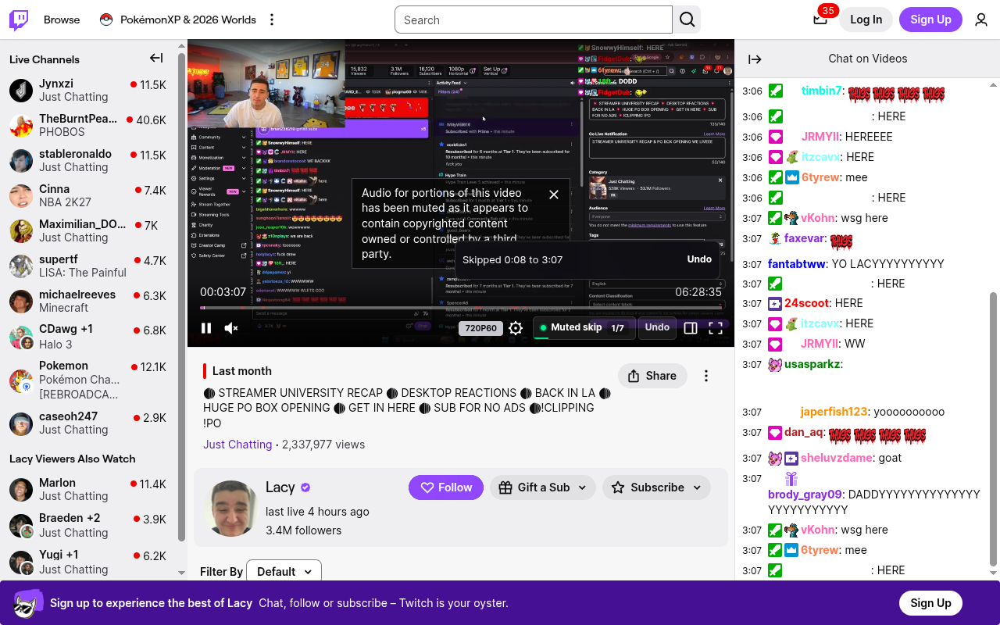

# SkipMute for Twitch

Browser extension for skipping Twitch VOD sections muted by Twitch Audio Recognition.

[](https://chromewebstore.google.com/detail/skipmute-for-twitch/joigloedgnkomhlekekfopbbeanlkcnp)
[](https://addons.mozilla.org/en-US/firefox/addon/skipmute-for-twitch/)



Works while logged out with no Client ID, token, or setup. By default, muted ranges are read from Twitch's seekbar and verified against captured playback audio locally in the page. Analysis does not reroute the player's sound.

## Features

- Inline Twitch player control near the right-side player buttons.
- Automatic skip when playback reaches a detected muted segment.
- Progress badge showing muted segments passed over total muted segments.
- Undo after every automatic skip.
- Skip action after Undo so long muted sections can be re-skipped when the user is ready.
- Zero-setup, audio-confirmed timeline-marker detection.
- Optional official Twitch Helix API credentials.
- Automatic recovery when Twitch rebuilds its player controls.

## Browser Targets

- Firefox 142+ desktop: `manifest.json` uses Manifest V2 and Firefox's built-in data consent.
- Chrome 99+: `manifest.chrome.json` uses Manifest V3, which is required for Chrome publishing.

## Local Testing

### Firefox

1. Open `about:debugging#/runtime/this-firefox`.
2. Click **Load Temporary Add-on**.
3. Select `manifest.json`.
4. After edits, click **Reload** beside the temporary add-on and refresh the Twitch VOD tab.

### Chrome

1. Run `npm run package:chrome`.
2. Open `chrome://extensions`.
3. Enable Developer mode.
4. Click **Load unpacked**.
5. Select `dist/chrome`.

### Automated checks

Browser tests require Node.js 20+ and the Playwright browsers. Packaging alone still supports Node.js 18+.

```sh
npm ci
npx playwright install chromium firefox
npm run check
npm run test:browser
```

The browser suite uses generated media with known audible and silent intervals. Browser output is silenced without muting the audio being analyzed. It checks automatic skipping, Undo/re-skip, false marker rejection, user audio controls, and player/navigation recovery in Chromium and Firefox. It reports case counts and skip latency. These fixture results are regression checks, not a claim of universal Twitch accuracy.

On headless Linux, Firefox needs a running audio server for Web Audio analysis. Both CI workflows start PulseAudio with a silent virtual output device before running browser tests.

For the separate live Twitch playback check, package Chrome and run `node scripts/live-smoke.cjs`. The default canary is a public Highlight with a muted interval. It can still be deleted by its broadcaster; unavailable content fails with an explicit error. Set `LIVE_SMOKE_VOD_URL` to another playable Twitch VOD with a muted interval at least 10 seconds long if it is removed. For scheduled GitHub runs, set the repository Actions variable `LIVE_SMOKE_VOD_URL`; manual Live Smoke runs also accept a `vod_url` input, which takes priority. This check needs Twitch and its media servers to be reachable.

## Packaging

```sh
npm run check
npm run package:firefox
npm run package:chrome
```

Packaging requires Node.js 18+. It uses PowerShell on Windows and Python 3's standard library on macOS/Linux. Packaging and the extension runtime require no dependencies; Playwright is a development-only browser test dependency.
CI also validates the packaged Firefox extension with Mozilla's pinned `web-ext` linter.

Outputs:

- `dist/twitch-vod-muted-skipper-firefox.zip`
- `dist/twitch-vod-muted-skipper-chrome.zip`

## Detection Sources

The extension tries detection in this order:

1. Official Twitch Helix API, if the user adds their own Client ID and OAuth bearer token.
2. Twitch player timeline markers, confirmed against the playing audio before SkipMute seeks.

Detection-source and credential changes apply to the open VOD without a page reload. API failures appear in the player control's tooltip.

Timeline detection waits for uninterrupted, progressing silent playback within a recognized seekbar marker. Pausing, buffering, seeking, user mute, and zero volume cannot confirm silence. If audio capture is unavailable, SkipMute leaves playback alone and explains the limitation in the control's tooltip. Turning off automatic skipping also leaves playback under your control.

To use the optional API, enter a matching Client ID and OAuth token in settings, then click **Save API credentials**. Firefox asks for consent from that click. Credentials are validated before saving and checked again at startup and hourly while configured and permitted. Invalid or mismatched credentials produce an explanation; timeline detection remains available. Legacy synced tokens migrate to local storage automatically, without opening settings.

## Privacy

See [PRIVACY.md](PRIVACY.md). The extension does not collect analytics, run remote code, or send data to non-Twitch services.

## Automatic store publishing

Publishing a **non-prerelease GitHub Release** triggers `.github/workflows/publish.yml`. CI checks that its tag is `v` plus the package version, runs unit/browser tests, builds and validates both ZIPs, and attaches them to the release. Independent Chrome and Firefox jobs then submit those exact ZIPs to the stores. Manual runs of **Publish Release** only check Chrome authentication and listing access; they do not build, upload, or publish. A failure in one store does not cancel the other.

Publishing submits the extension for store review; it does not bypass review or guarantee immediate availability. Chrome uses the v2 API with automatic publication after approval and supports short-lived GitHub OIDC credentials. [Chrome API publishing](https://developer.chrome.com/docs/webstore/api/reference/rest/v2/publishers.items/publish), [Firefox submission reference](https://extensionworkshop.com/documentation/develop/web-ext-command-reference/#web-ext-sign).

### One-time Chrome setup without a JSON key

The recommended route uses GitHub OIDC and Google Workload Identity Federation through a service account. GitHub obtains a short-lived token for each run; no JSON private key or OAuth refresh token is needed. [Google authentication action](https://github.com/google-github-actions/auth), [Chrome service-account authentication](https://developer.chrome.com/docs/webstore/service-accounts).

1. Select the Google Cloud project used for publishing. Find the existing service account under **IAM & Admin → Service Accounts**, or create one without project roles.
2. In the [Chrome Web Store Developer Dashboard](https://chrome.google.com/webstore/devconsole), open **Account** and link that service account's email. Chrome currently permits one linked service account per publisher, so reuse the existing one when applicable.
3. Open [Google Cloud Shell](https://shell.cloud.google.com/) and run the following once, using the SkipMute project and linked service account below. This creates the GitHub identity pool/provider and permits this repository's publishing workflow to impersonate the linked account.

```sh
CWS_PROJECT_ID='skipmute'
CWS_SERVICE_ACCOUNT='skipmute-publisher@skipmute.iam.gserviceaccount.com'
CWS_PROJECT_NUMBER="$(gcloud projects describe "$CWS_PROJECT_ID" --format='value(projectNumber)')"

gcloud services enable chromewebstore.googleapis.com iam.googleapis.com iamcredentials.googleapis.com sts.googleapis.com \
  --project="$CWS_PROJECT_ID"

gcloud iam workload-identity-pools create skipmute-github \
  --project="$CWS_PROJECT_ID" --location=global --display-name='SkipMute GitHub'

gcloud iam workload-identity-pools providers create-oidc skipmute-publish \
  --project="$CWS_PROJECT_ID" --location=global --workload-identity-pool=skipmute-github \
  --issuer-uri='https://token.actions.githubusercontent.com' \
  --attribute-mapping='google.subject=assertion.sub,attribute.repository_id=assertion.repository_id,attribute.repository_owner_id=assertion.repository_owner_id,attribute.event_name=assertion.event_name,attribute.ref=assertion.ref,attribute.workflow_ref=assertion.workflow_ref' \
  --attribute-condition="assertion.repository_id == '1318724308' && assertion.repository_owner_id == '7705550' && ((assertion.event_name == 'release' && assertion.ref.startsWith('refs/tags/v') && assertion.workflow_ref.startsWith('Mahcks/skipmute-for-twitch/.github/workflows/publish.yml@refs/tags/v')) || (assertion.event_name == 'workflow_dispatch' && assertion.ref == 'refs/heads/main' && assertion.workflow_ref == 'Mahcks/skipmute-for-twitch/.github/workflows/publish.yml@refs/heads/main'))"

gcloud iam service-accounts add-iam-policy-binding "$CWS_SERVICE_ACCOUNT" \
  --project="$CWS_PROJECT_ID" --role=roles/iam.workloadIdentityUser \
  --member="principalSet://iam.googleapis.com/projects/$CWS_PROJECT_NUMBER/locations/global/workloadIdentityPools/skipmute-github/attribute.repository_id/1318724308"

gcloud iam workload-identity-pools providers describe skipmute-publish \
  --project="$CWS_PROJECT_ID" --location=global --workload-identity-pool=skipmute-github \
  --format='value(name)'
```

The trust condition restricts access using this repository's and owner's numeric IDs, this workflow's path, and either a version-tag release or a manual check on `main`. If you rename or transfer the repository, update the condition. [Google deployment-pipeline setup](https://cloud.google.com/iam/docs/workload-identity-federation-with-deployment-pipelines).

4. Under repository **Settings → Secrets and variables → Actions → Variables**, set:

| Variable | Value |
| --- | --- |
| `CWS_WORKLOAD_IDENTITY_PROVIDER` | The full `projects/.../locations/global/workloadIdentityPools/skipmute-github/providers/skipmute-publish` value printed above |
| `CWS_SERVICE_ACCOUNT` | The linked service-account email |
| `CWS_PUBLISHER_ID` | Publisher ID from Chrome's **Publisher → Settings**; the existing repository secret with this name also works |

5. After the workflow changes are on `main`, allow a few minutes for Google permissions to propagate. Open **Actions → Publish Release → Run workflow** on `main`. A successful run reports **Chrome access verified** without uploading or submitting anything. This confirms token creation, API availability, and access to this listing.
6. Once the check passes, delete the unused `CWS_SERVICE_ACCOUNT_JSON` GitHub secret and revoke its old key in Google Cloud if no other integration uses it. Keyless runs already ignore that secret.

The Chrome extension ID is `joigloedgnkomhlekekfopbbeanlkcnp`. The publisher and linked service account must own that item. Release tags must match the package version, and each store update must use a higher version than the existing upload. Chrome's listing/privacy declarations still need to be maintained in the dashboard when behavior changes.

Existing key-based configurations remain supported when both keyless variables are absent. To repair that route, upload the downloaded service-account key file directly rather than copying/reformatting its JSON:

```sh
gh secret set CWS_SERVICE_ACCOUNT_JSON --repo Mahcks/skipmute-for-twitch < /path/to/downloaded-service-account-key.json
```

Never paste a private key into chat or commit it to the repository. The previous Chrome run failed locally because the saved value was not a complete service-account key; Google authentication was never attempted. The keyless route avoids that formatting problem entirely.

### Firefox credentials

Generate credentials on [Mozilla's API credentials page](https://addons.mozilla.org/en-US/developers/addon/api/key/) using the account that owns SkipMute. Store these as repository secrets:

| Name | Value |
| --- | --- |
| `AMO_JWT_ISSUER` | Mozilla JWT issuer / API key |
| `AMO_JWT_SECRET` | Mozilla JWT secret |

Both secret names were already present when this workflow was configured. The Firefox manifest ID matches the existing AMO listing; keep that ID unchanged when updating. CI uses `web-ext sign --channel listed --approval-timeout 0` to submit without waiting for store approval.

### Publish each update

1. Choose a version higher than the published store version, for example `0.3.1` after `0.3.0`.
2. Update `package.json`, `manifest.json`, and `manifest.chrome.json` to that same version. Update the lockfile with `npm install --package-lock-only`.
3. Commit and push the changes, including this workflow, publishing script, and lockfile.
4. On GitHub → **Releases → Draft a new release**, select/create the matching tag (for example `v0.3.1`) on that commit. Leave **Set as a pre-release** unchecked, then click **Publish release**.
5. Watch **Actions → Publish Release**, then the two store dashboards for review status.

A tag push or an unpublished draft alone does not trigger submission. If one store job fails, fix its credentials or dashboard issue and use **Re-run failed jobs**, so the successful store is not unnecessarily resubmitted. Both store jobs require an existing, completed listing. No live store submission is made by local unit tests.

## Publishing Checklist

- Update the version in `package.json`, `manifest.json`, and `manifest.chrome.json`.
- Review the screenshots in `store-assets/chrome` and listing copy in [STORE_LISTING.md](STORE_LISTING.md).
- Review permissions rationale in [STORE_LISTING.md](STORE_LISTING.md).
- Run `npm run check`.
- Run `npm run test:browser` and the live Twitch playback check.
- Package both browser builds.
- Enter a VOD through Twitch's client-side navigation and confirm the control appears.
- Test Skip, Undo, and Skip again on a VOD with visible red muted timeline markers.
- Configure the repository secrets and variable described under **Automatic store publishing**.
- Publish a GitHub release tagged `vX.Y.Z`; CI attaches both packages and submits updates to Chrome and Firefox.
- Check both store dashboards for review results.
